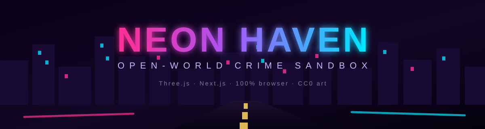
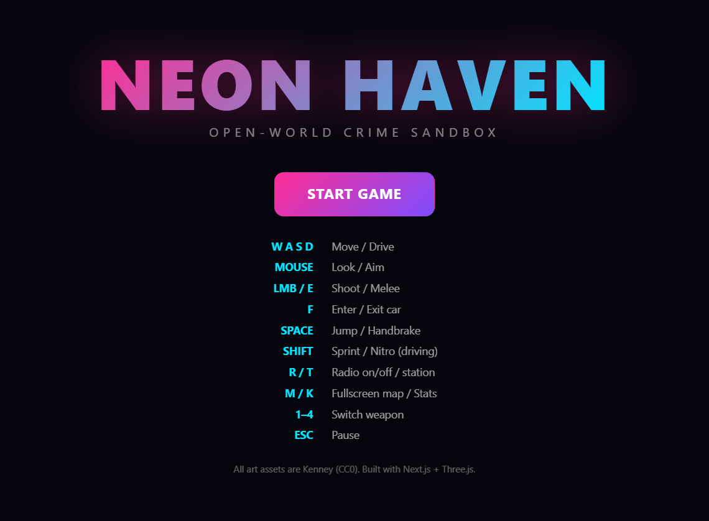

<div align="center">

# NEON HAVEN

### An open-world, GTA-style crime sandbox that runs entirely in your browser.



**[🎮 Play on Vercel](https://neon-haven-two.vercel.app)** · **[🎮 Play on GitHub Pages](https://aniruddhaadak80.github.io/neon-haven)** · [Source](https://github.com/aniruddhaadak80/neon-haven) · [Issues](https://github.com/aniruddhaadak80/neon-haven/issues)

      

</div>

---



Drive through a neon-lit city, complete missions, outrun the law, and cause chaos — all rendered in real-time 3D with Three.js. No install, no account, no downloads beyond the page itself.

```bash
git clone https://github.com/aniruddhaadak80/neon-haven.git
cd neon-haven
npm install
npm run dev
```

Open http://localhost:3000 and click **START GAME**.

## Features

### World
- **Procedural city** — districts (downtown skyscrapers, suburbs, industrial, parks), traffic lights, street lights, neon signs, and a full day/night cycle with a shader sky dome. The same seed always builds the same city.
- **Living world** — 16 AI traffic cars that follow lanes and brake for each other, 22 pedestrians that wander and flee danger, damage smoke, explosions, and a live minimap.
- **Fullscreen map** — hold `M` for a tactical overview: you, police, traffic, weapon/armor/health/bribe pickups, the Pay'n'Spray garage, and the mission marker.

### Driving
- **Drivable vehicles** — 19 car models with custom arcade physics: acceleration, braking, drifting (handbrake), body roll, spinning/steering wheels, and collisions. Enter/exit any car with `F` — parked, moving traffic, or cop cruisers.
- **Nitro boost** — hold `Shift` while driving to burn the nitro meter: 1.8× top speed, blue exhaust flames, camera shake. The meter regenerates when you coast.
- **Ride condition HUD** — your car's health and nitro show as live bars next to the speedometer; paint chars as it takes damage.
- **Drift scoring** — throw the handbrake and hold the slide: a pulsing `DRIFT ×` combo builds while you're slipping at speed, then banks into cash when the drift ends (500+ points unlocks an achievement).
- **Night traffic lights** — every nearby car (traffic and police) switches on headlights when the sun goes down.
- **Pay'n'Spray** — drive into the amber garage beacon to repair your ride and wipe your record for $200 (mapped as a diamond on the fullscreen map).

### Combat & crime
- **Weapons** — floating blasters hidden through the city: SMG, Rifle, and Heavy, each with its own damage, fire rate, tracer color, and gunshot pitch. Switch with `1–4`. Hitmarkers confirm your shots.
- **Melee combat** — punch and kick up close (`E`) with dedicated swing animations, hitmarkers, and kill streaks that pay bonus XP.
- **Wanted system** — commit crimes and police heat rises through 5 stars. Police chase, ram, and shoot back — gunfire chews up your car first, then you. Drop stars by staying out of sight, scrub heat with **bribe pickups** (gold shards), or go **undercover**: steal a cop car and heat decays faster while you're driving it.
- **Death matters** — get killed and you wake up at the hospital minus 10% cash, heat cleared, mission dropped.
- **Pickups** — blue armor shards (+50), red health packs (+50), gold bribes (−heat), all respawn over time.

### Missions & progression
- **Seven mission types** — courier deliveries, rampage wrecks, getaway escapes (only offered while wanted), taxi fares, checkpoint street races, assassinations with a living marked target, and multi-package stash runs — all with timers, map markers, and cash rewards.
- **Eight achievements** — First Blood, Unstoppable (5-kill streak), Wrecking Ball (10 wrecks), Public Enemy (5 stars), High Roller ($10k), Career Criminal (10 jobs), Veteran (level 5), and Drift King (500-point combo) — one-time toasts, persisted in your save, tracked in the stats overlay.
- **Career stats** — hold `K` for lifetime kills, missions, cash, streaks, achievements, and level. XP and cash persist in `localStorage`.
- **Procedural audio** — engine that revs with speed, two-tone police siren, gunfire, explosions, and a 3-station synth radio — all synthesized with WebAudio. Zero audio files.
- **Touch controls** — virtual joystick plus Fire / Punch / Jump / Brake / **Nitro** buttons on mobile.

## Controls

| Key | Action |
| --- | --- |
| `W A S D` | Move / Drive |
| Mouse | Look / Aim |
| `LMB` / `E` | Shoot / Melee |
| `F` | Enter / Exit car (steal anything — parked, traffic, cop cruisers) |
| `Space` | Jump (on foot) / Handbrake (driving) |
| `Shift` | Sprint (on foot) / **Nitro** (driving) |
| `1–4` | Switch weapon (pistol / SMG / rifle / heavy) |
| `R` / `T` | Radio on/off / next station |
| `M` (hold) / `K` (hold) | Fullscreen map / Career stats |
| `Esc` / `P` | Pause |

Walk up to any car — parked, traffic, even a cop cruiser — and press `F` to take it.
On touch devices you get a virtual joystick plus Fire / Punch / Jump / Brake / Nitro buttons.

## Tech

- **Next.js 15** (App Router) + **React 19** + **TypeScript** (strict)
- **Three.js** — the whole city merges into a handful of draw calls; pooled point-sprite particles; shader sky dome
- **Kenney** asset packs (CC0) for every model — cars, city kits, characters, weapons, nature
- No physics engine — custom arcade vehicle physics plus grid-based collision
- Deployed to **Vercel** (server build) and **GitHub Pages** (static export under `/neon-haven` via `NEXT_PUBLIC_BASE_PATH` + relative GLB texture URIs — see `.github/workflows/pages.yml`)

## Testing

```bash
npm test         # vitest — 55 tests
npm run typecheck
npm run lint
```

The suite covers the pure-logic core: math/RNG utilities, the wanted-level state machine (thresholds, decay, undercover cooldown, star drop), every one of the seven mission flows (offer → progress → complete/fail), collision resolution invariants, the drift-combo scorer (thresholds, banking, payout floors), the achievement unlock/restore logic, and an asset-manifest check that pins every model/texture the game references to disk. CI runs typecheck + tests before every Pages deploy.

## Project structure

```
src/
  app/            # Next.js routes + global styles
  components/     # React HUD, menus, minimap, fullscreen map, touch controls
  game/
    Game.ts           # orchestrator: scene, loop, camera, pickups, garage, maps
    config.ts         # all gameplay tunables + weapon defs + assetUrl()
    input.ts          # keyboard/mouse/pointer-lock (+ weapon hotkeys, touch)
    assets/           # GLB loading, vehicle/character factories
    world/City.ts     # procedural city generation + collision
    entities/         # Vehicle, Player, Ped
    systems/          # Traffic, Police, Wanted, Missions, DayNight, Audio, Particles
    __tests__/        # vitest suite (utils, wanted, missions, city, drift, achievements, assets)
public/
  models/         # prepared GLBs (regenerated by scripts/prepare-models.mjs)
docs/
  banner.svg          # README banner
  screenshot-title.png
scripts/
  fetch-assets.ps1    # download Kenney packs
  prepare-models.mjs  # rewrite GLBs into clean paths + relative texture URIs
.github/
  workflows/pages.yml # typecheck + tests + static-export build + Pages deploy
```

## Scripts

| Command | What it does |
| --- | --- |
| `npm run dev` | Local dev server |
| `npm run build` | Production build (Vercel layout) |
| `npm test` | Run the vitest suite |
| `npm run typecheck` | `tsc --noEmit` |
| `npm run lint` | ESLint |
| `npm run assets:fetch` | Download Kenney packs into `public/assets/` |
| `npm run assets:prepare` | Rebuild `public/models/` from the packs |

## Assets

All third-party art is from [Kenney](https://kenney.nl) and is licensed **CC0 1.0** (public domain). See [ATTRIBUTION.md](ATTRIBUTION.md).

The Kenney packs are downloaded by `scripts/fetch-assets.ps1` into `public/assets/` (git-ignored), then `scripts/prepare-models.mjs` rewrites a curated subset into `public/models/` with clean, space-free URLs and relative texture paths. To regenerate:

```bash
npm run assets:fetch
npm run assets:prepare
```

## License

[MIT](LICENSE) for the code. Game assets are CC0 (Kenney). See [ATTRIBUTION.md](ATTRIBUTION.md).
